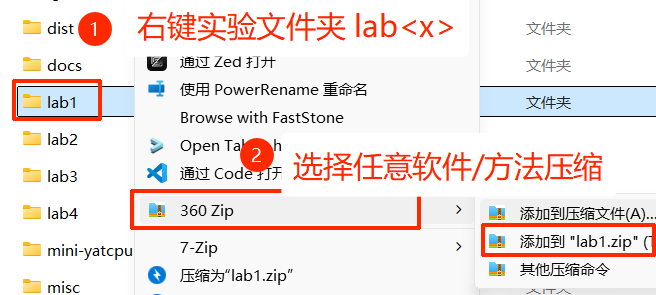
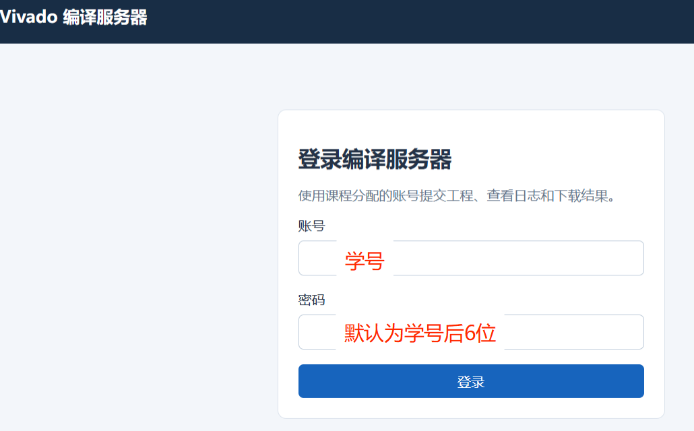
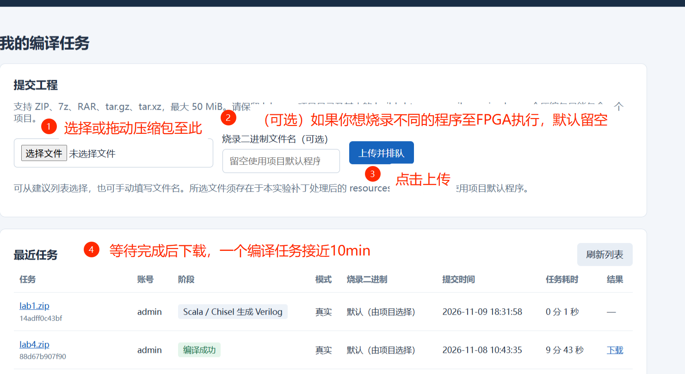
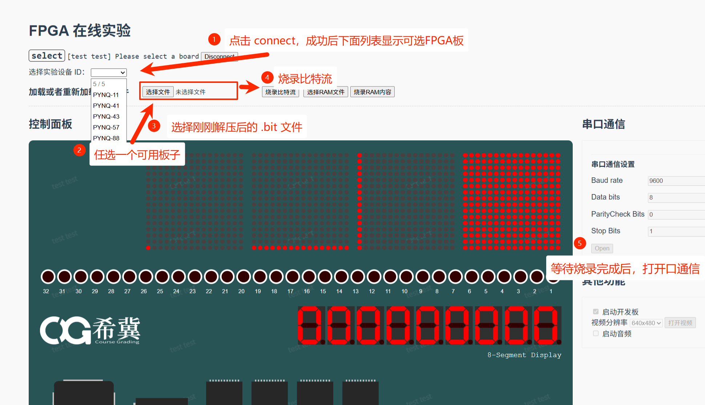

# 如何在云 FPGA 平台烧录您的 CPU

本教程展示如何在云平台上烧录您设计的 CPU 并在线查看烧板效果。

FPGA 云平台网址：[http://172.18.162.62/indexcs/simple.jsp?loginErr=0]()

Vivado 比特流编译服务器网址：[http://172.18.162.65/]()

## 预备条件

为了进行烧录，您需要满足以下条件：

1. 您的电脑处于中山大学校园网内
2. 您已完成至少一个 lab 的实验，且通过实验教程中要求的测试
3. 您的助教已为您创建云平台账号

## 编译比特流文件

这一步您将提交代码，服务器将排队处理后您可以下载含有比特流文件（后缀为 `.bit`） 的压缩包。

### Step 1. 准备您的代码包

!!! info 确保您的代码通过测试
    确保您的代码通过实验教程中要求的测试，否则烧录至 FPGA 上也是实现有错的CPU 。

    如果您添加了自定义的 CPU 运行程序，或针对教程不包含的板子进行烧录，建议备份后更新至最新的代码仓库。

将您的 lab<x> 文件夹右键压缩为压缩包（可为 zip、rar、tar.gz格式）。如果您的文件夹压缩后仍过大，可以先**备份并移除**包含测试后生成波形文件的 `test_run_dir` 目录，再压缩。

### Step 2. 登录

打开 [Vivado 比特流编译服务器网址](http://172.18.162.65/) ，输入助教告知的账号密码登录，一般默认账号为学号。

{width=70%}

### Step 3. 提交任务并下载

按下图所示提交任务。

{width=90%}

## 在云平台烧录并查看效果

### Step 4. 登录 FPGA 烧录平台

打开 [FPGA 云平台](http://172.18.162.62/indexcs/simple.jsp?loginErr=0)，同样输入账号密码登录。

进入页面后查看“正在进行中的作业”，选择相应的作业点击进入，直至打开烧录界面，如下图：

按上图操作后，根据烧录的程序不同，可以观察到 LED 变化，或打开串口后的输出（勾选ASCII mode 显示对应字符）。

!!! info 使用自定义的程序
    如果您希望使用自己的程序烧录，但难以动手或遇到服务器报错，请咨询当课助教。
